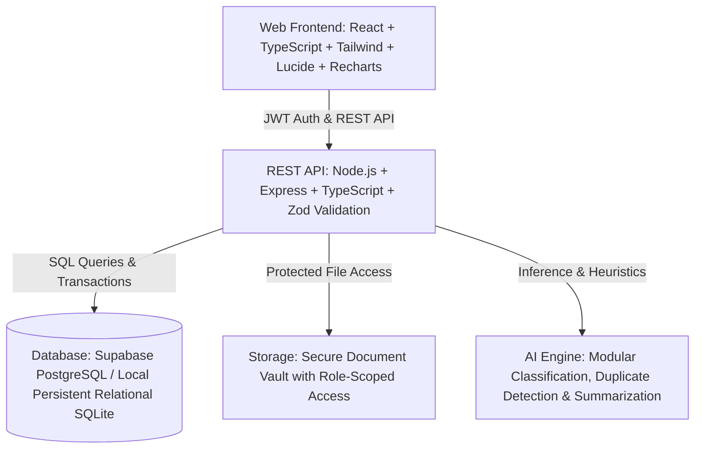
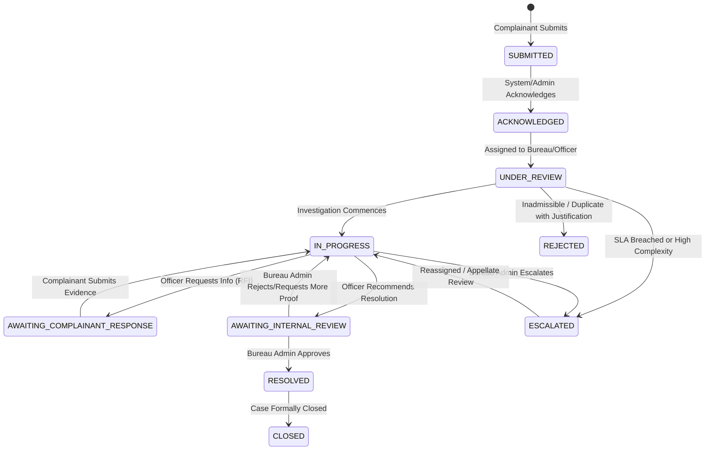

# SYNORA: System Architecture & Implementation Blueprint

## 1. Executive Summary
**SYNORA** is an institutional complaint monitoring, tracking, and resolution platform designed for AICTE bureaus and cells. It provides a centralized, transparent, and secure ecosystem connecting Complainants, Case Officers, Bureau Administrators, and System Administrators.

---

## 2. Architecture Overview



---

## 3. Role & Permission Matrix

| Role | Submit Complaint | View Own | View Bureau | View Assigned | Internal Notes | Reassign Case | Approve Resolution | Manage Users & Bureaus |
| :--- | :---: | :---: | :---: | :---: | :---: | :---: | :---: | :---: |
| **Complainant** | Yes | Yes | No | No | No (Hidden) | No | No | No |
| **Case Officer** | No | No | No | Yes | Yes (Read/Write) | No | Propose | No |
| **Bureau Admin** | No | No | Yes | Yes | Yes (Read/Write) | Yes | Yes | No |
| **System Admin** | No | No | Yes (Audit) | No | Audit Only | Yes | Audit | Yes |
| **Oversight Reviewer** | No | No | Read-only | Read-only | Read-only | No | No | No |

---

## 4. Complaint Lifecycle & State Machine



---

## 5. Directory Layout
```
SYNORA/
├── apps/
│   ├── web/                     # React + Vite + TypeScript frontend
│   │   ├── src/
│   │   │   ├── components/      # UI component library & brand assets
│   │   │   ├── layouts/         # Client & Admin layout shells
│   │   │   ├── pages/           # Portals (Complainant, Officer, Bureau Admin, System Admin)
│   │   │   ├── context/         # Auth & Notification contexts
│   │   │   ├── services/        # API client bindings
│   │   │   └── types/           # Shared TypeScript interfaces
│   │   └── package.json
│   └── api/                     # Node.js + Express backend
│       ├── src/
│       │   ├── controllers/     # Route handlers
│       │   ├── middleware/      # Auth, RBAC, error handling, rate limiting
│       │   ├── services/        # Business logic, workflows, SLA, AI engine
│       │   ├── db/              # Migrations, seed data, database adapter
│       │   ├── routes/          # Express route definitions
│       │   └── schemas/         # Zod schemas for validation
│       └── package.json
├── supabase/
│   ├── migrations/              # SQL migrations with RLS policies
│   └── seed.sql                 # Fictional seed dataset
├── docs/                        # API spec, architecture documentation
├── .env.example
├── package.json                 # Monorepo orchestration
└── README.md
```
